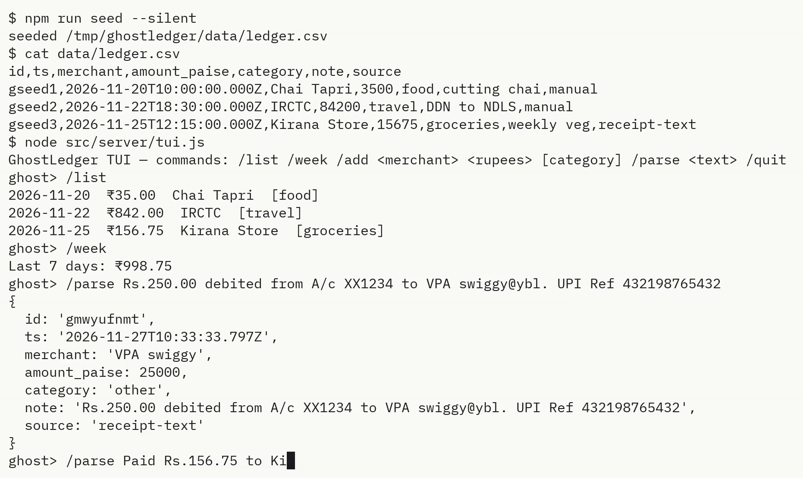
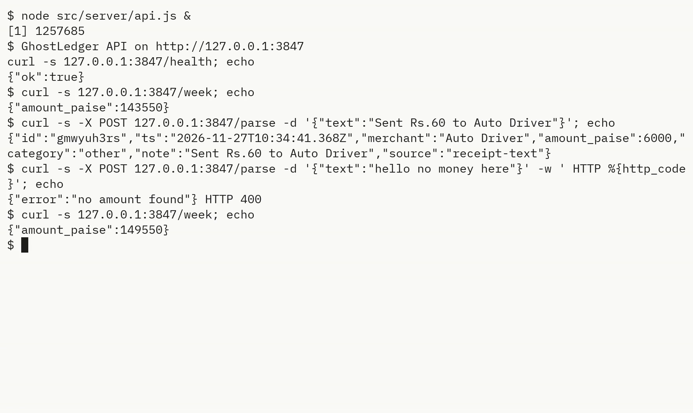
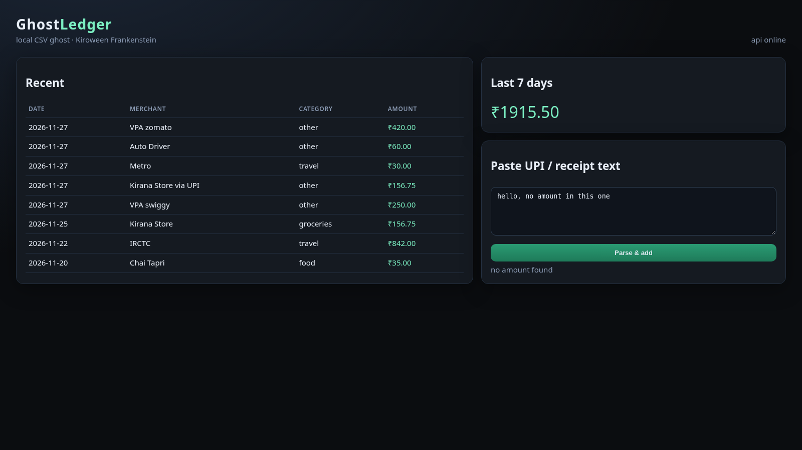

# GhostLedger

A local expense ledger that lives in a CSV file, with a terminal UI and a small web dashboard.

<p align="center">
  <a href="LICENSE"></a>
  
  
  
  <a href="https://kiroween.devpost.com/"></a>
</p>

## What it is

GhostLedger keeps everyday spending in `data/ledger.csv` on your machine. You can add a row by hand, or paste a UPI SMS or receipt text and have it pick out the merchant and amount. The same file is what the terminal UI, the local HTTP API and the local web page all read and write. Nothing is sent to a server.

Amounts are stored as integer paise (₹1.00 is `100`). There are no npm packages to install; it uses the Node.js standard library only.

## Demo video

<p align="center">
  <a href="https://youtu.be/e6PdNCmWoQI"></a>
</p>

A 2-minute walkthrough of the terminal UI, the local API and the web dashboard.

## Screenshots

Captured from a fresh clone running on Node 24, with `npm run seed` and the commands shown.

| Terminal UI | Local API | Web page |
|---|---|---|
|  |  |  |

## Why I built it

I started this as my entry for [Kiroween 2026](https://kiroween.devpost.com/), in the Frankenstein category, which asks you to stitch unlike tools into one project. The practical problem is one I actually have: UPI messages and paper receipt text pile up in my notifications, and I did not want another cloud budgeting app. A plain CSV I can open in a spreadsheet, a keyboard UI I can query with `/week`, and a local page that reads the same file, felt like the right mashup.

This is version 0.1.0, an early starter. It works for text I type or paste. It does not yet read a photo of a receipt.

## Features

- A CSV ledger (`data/ledger.csv`) as the only store, with columns `id`, `ts`, `merchant`, `amount_paise`, `category`, `note`, `source`.
- A receipt-text parser for amounts written with `₹`, `INR` or `Rs`, and a merchant after `at`, `to` or `from`.
- A keyboard TUI: `/list`, `/week`, `/add`, `/parse`, `/quit`.
- A local API on `127.0.0.1:3847` (`/health`, `/expenses`, `/week`, `POST /expenses`, `POST /parse`).
- A local dashboard on `127.0.0.1:3848` that lists recent rows, shows the last-7-day total, and can parse pasted text.
- `npm run seed` writes three sample rows so you can try it immediately.
- Two automated tests, run with `npm test`.

## Quick start

You need [Node.js](https://nodejs.org/) 18 or newer. I ran everything below on Node 24.22.1. There are no packages to install.

### Windows (PowerShell)

```powershell
git clone https://github.com/PrafullJ0shi/ghostledger.git
cd ghostledger
npm run seed
```

In two more terminals, from the same folder:

```powershell
npm run api    # http://127.0.0.1:3847
npm run web    # http://127.0.0.1:3848  — open this in a browser
```

Optional terminal UI, and the tests:

```powershell
npm run tui
npm test
```

### macOS and Linux

The commands are the same, in bash or zsh:

```bash
git clone https://github.com/PrafullJ0shi/ghostledger.git
cd ghostledger
npm run seed
npm run api    # one terminal: http://127.0.0.1:3847
npm run web    # another terminal: open http://127.0.0.1:3848
npm run tui    # optional
npm test
```

## Usage

After `npm run seed`, the terminal UI prints the sample rows like this (I ran this at 15:33 IST on 27 Nov 2026):

```
ghost> /list
2026-11-20  ₹35.00  Chai Tapri  [food]
2026-11-22  ₹842.00  IRCTC  [travel]
2026-11-25  ₹156.75  Kirana Store  [groceries]
ghost> /week
Last 7 days: ₹998.75
```

The Chai Tapri row (20 Nov 2026, 10:00 UTC) was just older than 168 hours at that moment, so `/week` left it out. The window is a rolling 168 hours, not calendar days.

Adding a row by hand, and parsing a UPI-like line:

```
ghost> /add TestCafe 42.50 food
{
  id: 'gmwytdemk',
  ts: '2026-11-27T10:03:49.196Z',
  merchant: 'TestCafe',
  amount_paise: 4250,
  category: 'food',
  note: '',
  source: 'manual'
}
ghost> /parse Paid Rs.99.00 to Metro via UPI
{
  id: 'gmwytdemm',
  ts: '2026-11-27T10:03:49.198Z',
  merchant: 'Metro via UPI',
  amount_paise: 9900,
  category: 'other',
  note: 'Paid Rs.99.00 to Metro via UPI',
  source: 'receipt-text'
}
ghost> /week
Last 7 days: ₹1140.25
```

New ids and timestamps will differ when you run it. The merchant on the parsed row is `Metro via UPI` because the parser currently takes the words after `to` and does not stop at `via`.

The same seed file, through the API:

```bash
curl -sS http://127.0.0.1:3847/health
# {"ok":true}

curl -sS http://127.0.0.1:3847/week
# {"amount_paise":99875}

curl -sS -X POST http://127.0.0.1:3847/parse \
  -H 'content-type: application/json' \
  -d '{"text":"Paid Rs.156.75 to Kirana Store via UPI"}'
# 201, with amount_paise 15675. The merchant is stored as "Kirana Store via UPI".

curl -sS -X POST http://127.0.0.1:3847/parse \
  -H 'content-type: application/json' \
  -d '{"text":"hello no money here"}'
# 400 {"error":"no amount found"}
```

On Windows PowerShell you can use `curl.exe` with the same flags, or:

```powershell
Invoke-RestMethod http://127.0.0.1:3847/health
Invoke-RestMethod http://127.0.0.1:3847/week
```

`npm test` on this box (Node 24.22.1) reported 2 passing, 0 failing.

## How it works

1. Every expense is one row in `data/ledger.csv`. If the file is missing, it is created with a header.
2. `parseReceiptText` looks for an amount next to `₹`, `INR` or `Rs`, and a merchant after `at`, `to` or `from`.
3. The TUI talks to the ledger functions directly. The API on port 3847 exposes the same functions over HTTP, bound to localhost. The page on port 3848 is a static file; the browser calls the API on port 3847.
4. The API does not make outbound network calls. CORS is open (`*`) because the dashboard is also local.

## Project structure

```
.kiro/              Kiro specs, steering, and a save hook that runs the tests
src/server/ledger.js   read, write, week sum, receipt-text parser
src/server/api.js      HTTP API on 127.0.0.1:3847
src/server/tui.js      keyboard UI
src/server/static.js   static file server on 127.0.0.1:3848
src/server/seed.js     writes three sample rows
src/web/index.html     dashboard
tests/ledger.test.js   two node:test checks
data/ledger.csv        your ledger (gitignored; created by seed or first use)
LICENSE                MIT
CHANGELOG.md
```

## Limits

- Text only. There is no photo OCR yet, even though that is the obvious next step for paper receipts.
- The parser is a small regex. It misses lines with no rupee marker, and it can swallow trailing words, as in `Metro via UPI` above.
- Amounts with a thousands separator are misread: `INR 1,200.00` is parsed as ₹1.00.
- Credit messages are not told apart from debits, so a "credited" SMS would be stored as spending.
- `/week` is the last 168 hours from the moment you ask, not "the last seven calendar days".
- Amounts and the UI assume Indian rupees.
- The ledger is one local file. There is no account, no sync and no encryption beyond whatever your disk already has.
- The dashboard needs both `npm run api` and `npm run web` running.
- The tests append a row to the real `data/ledger.csv` rather than a temporary file.
- I have not yet done the remaining build inside Kiro itself. The `/.kiro` folder is present so the repo meets the hackathon layout rules; the write-up will need to describe real Kiro use.

## Roadmap

- Tighter merchant parsing (stop at `via`, and similar suffixes).
- Reading a photo of a receipt (on-device OCR).
- TUI commands `/cat` and `/export`, and simple category rules.
- Charts on the dashboard, still fed by the same CSV.
- A short demo video and a write-up of how Kiro was used, for the Kiroween submission (due 5 Dec 2026, 03:30 IST).

## License

MIT. See [LICENSE](LICENSE).
